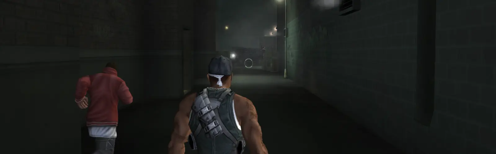
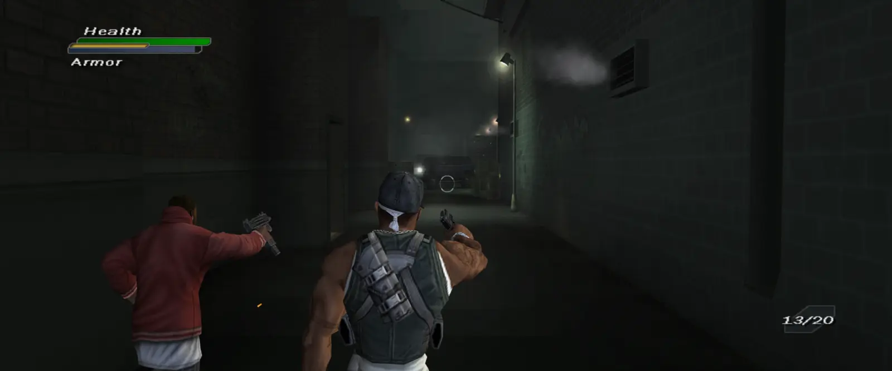
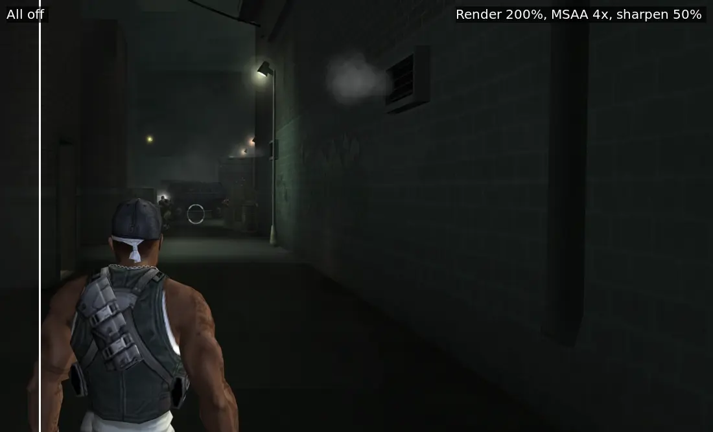
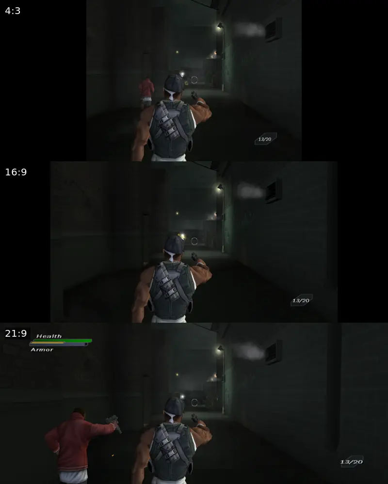
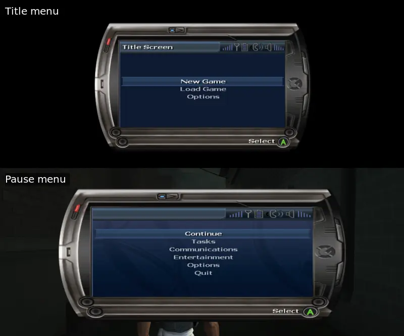
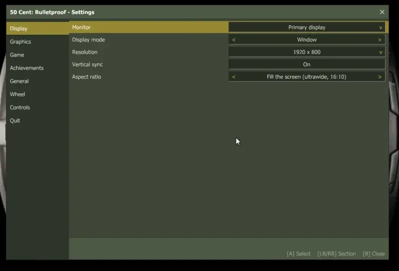
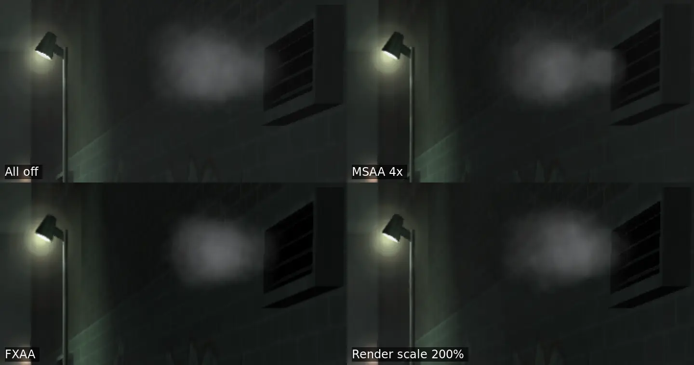
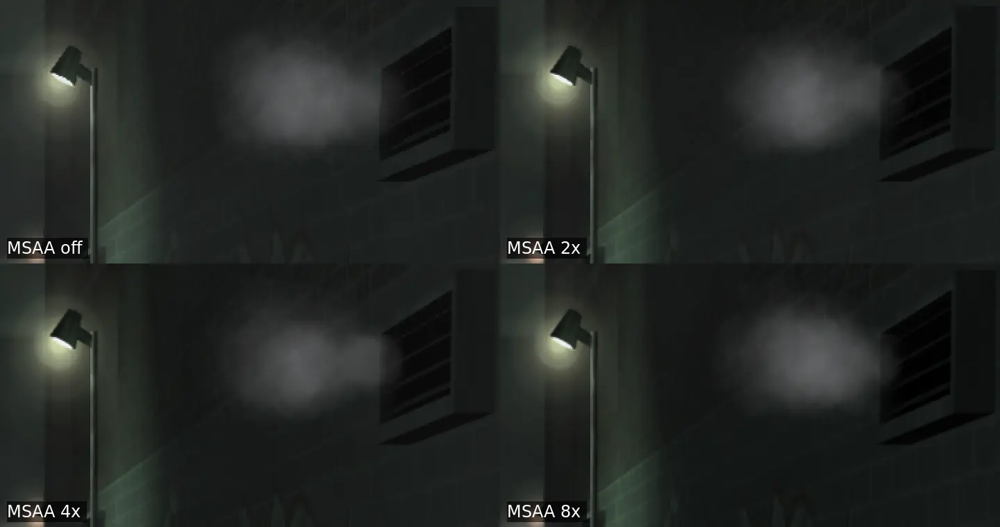
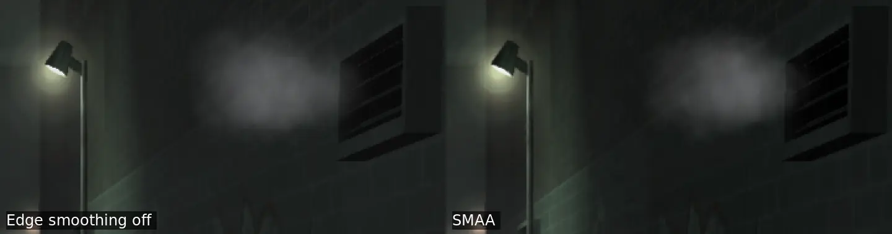
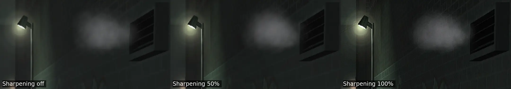

  

  
  
  

  <a href="#getting-started"><b>Getting started</b></a> &nbsp;·&nbsp;
  <a href="#building"><b>Building</b></a> &nbsp;·&nbsp;
  <a href="https://discord.gg/PQjkKsdtc"><b>Discord</b></a>

  

**The 2005 Xbox shooter, running natively on PC.** This is not an emulator. The game's own x86 code is statically
recompiled with the [Xbox XBE Recomp](https://github.com/TGP482/XboxXBE-Recomp) toolkit into a Windows program, with
a new renderer, sound and input underneath: true widescreen up to 21:9 and beyond, sharper graphics, mouse aim and
keyboard, modern pads, a mouse pointer in the menus, achievements and the PC settings a button away in the game's own
Options page.

> [!NOTE]
> This project does not include any game assets. You need your own copy of the Xbox game to build and play.

> [!WARNING]
> Work in progress: the story has been played from the start, but not yet through every mission on PC.

## Table of contents

- [Xbox vs. PC](#xbox-vs-pc)
- [Features](#features)
- [Widescreen and the HUD](#widescreen-and-the-hud)
- [PC Settings](#pc-settings)
- [Graphics settings](#graphics-settings)
- [Controls](#controls)
- [Achievements](#achievements)
- [Requirements](#requirements)
- [Getting started](#getting-started)
- [FAQ](#faq)
- [Known issues](#known-issues)
- [Roadmap](#roadmap)
- [Community and support](#community-and-support)
- [Building](#building)
- [Credits and legal](#credits-and-legal)

## Xbox vs. PC
[(Back to top)](#table-of-contents)

  
   
  <i>All extras off vs. render scale 200%, MSAA 4x and sharpening 50%, at 1920x800 (21:9).</i>

The Xbox drew Bulletproof at 640x480, at 4:3 or squeezed for a 16:9 TV, at 30 frames a second. The port draws it at
your screen's resolution and shape at 60, with anti-aliasing and sharpening layered on top of the game's own picture.

## Features
[(Back to top)](#table-of-contents)

| | |
|---|---|
| **Widescreen** | True proportions on any screen, 21:9 and wider included. Play fills the screen with the 3D view widened; the menus, movies and in-engine cutscenes keep their 4:3 shape in the middle. |
| **Aspect, changed as you play** | Auto, 4:3, 16:9 or fill the screen, applied at once, mid-mission too. The HUD follows. |
| **HUD at the edges** | On a wide screen the health bar, cash and weapon panel sit at the screen's sides, as on a 16:9 TV, not squeezed into the middle. |
| **60 frames a second** | The console ran at 30. The game's simulation follows the clock, so it plays at its own speed. |
| **Sharper graphics** | Render scale up to 200%, MSAA up to 8x, FXAA or SMAA, sharpening, anisotropic filtering and enhanced world textures. |
| **PC Settings in the game** | **Y** on the game's Options page (from the title and the pause menu) opens them; **F1** anywhere. Saved in `settings.toml`. |
| **Mouse and keyboard** | WASD and mouse aim that turns the camera directly, as in a PC shooter, not as a stick. The button prompts show your keys while you play on the keyboard. |
| **Mouse in the menus** | A pointer of its own in the PDA's colours: point at a row to highlight it and click to choose it, in lists too; right click goes back, the wheel scrolls. |
| **Controllers** | Xbox, PlayStation and Switch pads with hot plugging and rumble. **Modern button pictures** show today's Xbox pad: LB and RB for White and Black, LT and RT, View and Menu. |
| **Achievements** | 22, for the story's missions, the hardest difficulties, the store's disarms and weapons, Grizz medals and cash, kept in `achievements.toml` beside the game. |
| **Field of view** | 50 to 150% of the game's, changed at once; aiming zooms in proportion. |
| **Quality of life** | Skip the intro movies, hide the HUD (F9) for screenshots, Quit Game on the title menu, sharp text and HUD at high resolutions, F12 screenshots at full resolution, Alt+Enter for full screen, an optional boot splash (`splash.png` beside the game). |

## Widescreen and the HUD
[(Back to top)](#table-of-contents)

  
   
  <i>ASPECT RATIO: 4:3, 16:9 and fill the screen (21:9), in a 1920x800 window.</i>

In play the 3D view is widened to your screen's shape, and the HUD's pieces move out to its edges: the health bar
and armour to the top left, the cash to the top right, the weapon and ammo to the bottom right. The aspect can be
changed in the settings while you play, and the view and HUD follow at once.

  
   
  <i>The PDA's menus keep their 4:3 shape on a wide screen, the pause menu over the paused game.</i>

The movies and the in-engine cutscenes are shown whole at 4:3 in the middle, with black at the sides, as they were
made.

## PC Settings
[(Back to top)](#table-of-contents)

  

The game's **Options** page, on the title menu and in the pause menu, shows **Y PC Settings** in its button bar: **Y**
opens the settings window over the game. **F1** (or Back + Start on a pad) opens it anywhere. Pad, keyboard and mouse
all work in it: LB and RB (or Page Up and Page Down) change the page.

| Page | Settings |
|---|---|
| **Display** | Monitor, display mode (full screen, borderless, window), resolution, vertical sync, aspect ratio |
| **Graphics** | Render scale, anisotropic filtering, frame rate cap, MSAA, smooth alpha edges, edge smoothing (FXAA, SMAA), scaling filter, sharp text and HUD, enhanced world textures, sharpening, low latency, show frames a second, renderer (Direct3D 12 or 11) |
| **Game** | Skip intro movies, hide the HUD, field of view, modern button pictures |
| **Achievements** | Every achievement, with your unlocks and when they happened |
| **Controls** | Key and button bindings, mouse sensitivity and the sticks |

Everything is saved in `settings.toml` beside the game.

## Graphics settings
[(Back to top)](#table-of-contents)

Shots of one spot in the first mission at 1920x800, taken one after another on an Intel Arc A750; the close-ups of
the alley's lamp and vent are enlarged twice.

  
   
  <i>Edges: all off, MSAA 4x, FXAA and render scale 200%.</i>

- **MSAA** smooths the edges of the 3D scene and keeps textures sharp. The more samples, the slower.

  
   
  <i>MSAA off, 2x, 4x and 8x.</i>

- **Edge smoothing** works on the finished frame, HUD included: FXAA softens it a little, SMAA keeps it crisper.

  
   
  <i>Edge smoothing off vs. SMAA.</i>

- **Render scale** draws the picture larger than the screen: the smoothest fine detail, and the slowest.
- **Sharpening** makes the picture crisper. Around 50% is a good start.

  
   
  <i>Sharpening off, 50% and 100%.</i>

- **Smooth alpha edges** soften fences, wire and other cut-out textures, with MSAA on.
- **Texture filtering** keeps streets and walls sharp into the distance.
- **Scaling filter** chooses how the frame reaches the screen when render scale is not 100%: bilinear, or sharp.
- **Enhanced world textures** double the 3D scene's textures in the background. They use more video memory and can
  cause a brief hitch as new ones appear.

## Controls
[(Back to top)](#table-of-contents)

| Action | Keyboard and mouse | Pad |
|---|---|---|
| Move | W A S D | left stick |
| Camera, aim | mouse | right stick |
| Fire | left mouse button | RT |
| Crouch | C, Ctrl | LT |
| Jump | Space | A |
| Hostage, execute, grab cover | F | B |
| Action, reload, counter-kill, cover | E, R | X |
| Evade, dive, dual-wield | Shift | Y |
| Heal | H | LB |
| Weapon inventory | Q, middle mouse button | RB |
| Music track | Tab | View |
| Pause (the G-Unit PDA) | Esc, P | Menu |
| Hide the HUD | F9 | |
| Screenshot | F12 | |
| Settings window | F1 | Back + Start |
| Full screen | Alt+Enter | |
| Quit Game (title menu) | E, R | X |
| Menus | point and click, or arrows, Enter and Backspace; right click goes back, the wheel scrolls | d-pad, A, B |

Keys and buttons can be changed in the settings window's **Controls** page.

## Achievements
[(Back to top)](#table-of-contents)

22 achievements, 555 points, kept in `achievements.toml` beside the game. The settings window's **Achievements** page
lists them with your unlocks.

| Achievement | How | Points |
|---|---|---|
| Queens, Safe House, Junkyard, Chinatown, Disused Subway, Projects, Docklands, City Morgue, Little Italy | Complete that mission | 10 each |
| Vessel | Finish the story | 25 |
| Hard Road | Finish the story on Gangsta or G-Unit Soldier | 50 |
| Soldier Through | Finish the story on G-Unit Soldier | 100 |
| Decorated / Full Rack | Pick up a Grizz medal / all 10 | 10 / 50 |
| New Move / Close Quarters / Every Answer | Buy a disarm / own 10 / all 25 | 10 / 25 / 50 |
| Armed Up / Full Arsenal | Get a new weapon / all 20 | 10 / 50 |
| Pocket Money / Stacking Up / Six Figures | Carry $10,000 / $50,000 / $100,000 | 10 / 25 / 50 |

## Requirements
[(Back to top)](#table-of-contents)

- **Your own copy of the game:** the USA/Europe Xbox release (one disc for both), title id 56550042, `default.xbe`
  SHA-1 `0abb01d5e8b323f13d26ac98b619e42220795093`. An `.iso` image of your disc, or a folder with its files.
- **Windows 10 or 11, 64 bit**, and a graphics card with Direct3D 12 (Direct3D 11 also works).
- **Tested on AMD and Intel Arc graphics:** an AMD Radeon RX 7900 XT at 3440x1440 and an Intel Arc A750 at 1080p.
  NVIDIA cards are expected to work, as nothing here is specific to a vendor, but have not been tested yet: please
  report how yours runs.
- **Minimum spec:** any 64 bit processor from the last ten years and a Direct3D 12 graphics card run the game at 60
  frames a second.

## Getting started
[(Back to top)](#table-of-contents)

`BulletproofLauncher.exe` does everything for you: no Visual Studio, no Git, no command line, nothing installed in
Windows and no admin rights needed. It and a build from source both make the game's code on your own PC from your own
disc: it is never downloaded, only the program around it.

1. Download `BulletproofLauncher.exe` from the [latest release](https://github.com/hk21x/50cent-recomp/releases/latest).
2. Put it in a folder of its own with a short path (for example `C:\Games\Bulletproof`) and run it. Everything it makes
   goes in a `Bulletproof` folder beside it. Windows may warn about an unrecognised app: choose **More info**, then
   **Run anyway**.
3. **Your game:** choose your disc image (`.iso`) or the folder with the disc's files. The launcher checks that it is
   the supported release (USA/Europe).
4. **Get the game ready:** the launcher downloads the game's package (the program and a compiler, no game code), then
   your PC builds the game's code from your disc. You can stop at any time; it carries on where it left off.
5. **Play.**

When a new release is out, the launcher offers it at the top of its window: **Update the launcher**, then **Update**.
The new version is built beside the game and only replaces it once it is ready, keeping your saves and settings.

Files, all under the `Bulletproof` folder beside the launcher:
- `play\`: `Bulletproof.exe`, `settings.toml`, `hdd\` (your profiles and saves), `logs\`, `achievements.toml`,
  `screenshots\`, `compiler\`
- `launcher.log`, the launcher's log (send it with any problem)

To remove everything, delete the launcher and its `Bulletproof` folder (keep `play\hdd` if you want your saves).

## FAQ
[(Back to top)](#table-of-contents)

<b>Is this an emulator?</b>

 
No. The game's x86 code is translated ahead of time into C++ and built as a Windows program. The Xbox's graphics,
sound and input are rebuilt for the PC underneath it. That is what makes true widescreen with the HUD at the edges, 60
frames a second, mouse aim and settings inside the game's menus possible.

<b>Why do I need my own copy of the game?</b>

 
The game belongs to its rights holders. This project shares only its own work: the game's code and assets are made
from your disc when you build.

<b>The mouse turns the camera too fast or too slow.</b>

 
Change the mouse sensitivity in the settings window's <b>Controls</b> page (F1, or Y on the game's Options page).

<b>Something is wrong. What should I send?</b>

 
The first lines of the log in <code>logs\</code> beside the game list your settings and GPU. Please include that file
when you report a problem on the <a href="https://discord.gg/PQjkKsdtc">Discord server</a>.

## Known issues
[(Back to top)](#table-of-contents)

- **Not yet covered by testing:** the whole story on PC, the arcade and NVIDIA graphics cards.
- **The mouse pointer** highlights rows in the PDA's menus and lists; the name keyboard and the store take a click as
  A on the highlighted choice, and sliders and switches are changed with the arrows.

## Roadmap
[(Back to top)](#table-of-contents)

- **The whole story played through on PC**, with fixes for whatever it finds.
- **More achievements**, for the music and videos the store unlocks, and for combat.
- **The pointer everywhere:** the name keyboard, the store and the settings rows.

## Community and support
[(Back to top)](#table-of-contents)

Join the [Discord server](https://discord.gg/PQjkKsdtc) for help getting the game running, to report problems, and
to talk about the port with other players.

## Building
[(Back to top)](#table-of-contents)

For developers.

1. Clone with submodules: `git clone --recurse-submodules https://github.com/hk21x/50cent-recomp`.
2. Put your disc in `assets`: an `.iso`, or `default.xbe` with the game's folders beside it.
3. Install Visual Studio 2022 with **Desktop development with C++**, **C++ Clang tools for Windows** and **C++ CMake
   tools for Windows** (`build.bat` offers to add the last two), and run `build.bat`. The first build recompiles the
   game and takes a while. `Bulletproof.exe` is in `out\build\release`.

## Credits and legal
[(Back to top)](#table-of-contents)

- [Xbox XBE Recomp](https://github.com/TGP482/XboxXBE-Recomp), the recompiler and runtime this is built on.
- [XenonRecomp](https://github.com/hedge-dev/XenonRecomp) for the overridable function layout and instruction hooks.
- [Zydis](https://github.com/zyantific/zydis) for decoding x86 instructions, [toml++](https://github.com/marzer/tomlplusplus)
  for the configs, [Dear ImGui](https://github.com/ocornut/imgui) for the settings overlay and
  [SDL](https://github.com/libsdl-org/SDL) for the window, input and controllers.

*50 Cent: Bulletproof* © its respective rights holders. Developed by Genuine Games and published by Vivendi Universal
Games. This is an unofficial fan project, not affiliated with or endorsed by them or by the artist. No game code or
assets are distributed: they are made from your own copy of the game.

**AI disclosure:** much of this project's code, tooling and documentation was written with AI assistance (Anthropic's
Claude), directed, reviewed and playtested by the author.
